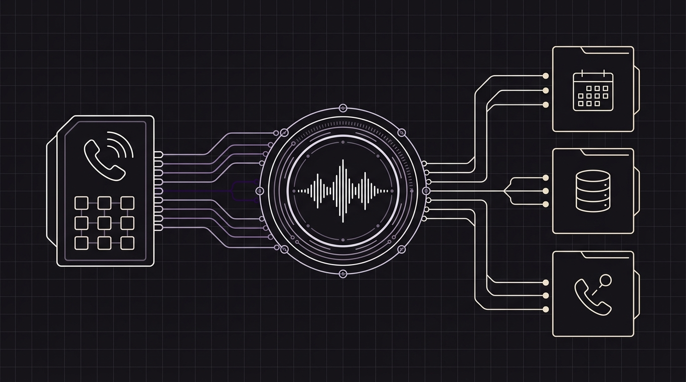

# Orbitali, el motor de tu centralita: Cómo ofrecer centralitas con IA en marca blanca a tus clientes

Si tu empresa comercializa **centralitas virtuales**, servicios de telefonía para empresas o software de gestión para sectores como clínicas, hoteles, inmobiliarias o despachos profesionales, seguro que ya has notado un cambio en el mercado. Tus clientes ya no se conforman con desviar llamadas o configurar una locución tradicional: **quieren una centralita con inteligencia artificial que atienda el teléfono por ellos.**

Los clásicos menús telefónicos de *«Pulse 1 para administración, pulse 2 para pedir cita»* generan frustración y hacen que muchos clientes cuelguen antes de ser atendidos. Hoy, cualquier pyme o negocio local busca una **recepcionista virtual inteligente** capaz de contestar al instante las 24 horas del día, conversar con naturalidad, resolver dudas frecuentes, agendar citas directamente en su calendario y pasar la llamada a una persona del equipo cuando se trata de algo urgente.

Para una empresa que ofrece centralitas o soluciones digitales a otros negocios, esta demanda es una oportunidad comercial enorme. Pero también plantea una gran pregunta: **¿cómo puedes ofrecer la mejor tecnología de voz con IA bajo tu propia marca sin gastar años ni cientos de miles de euros en desarrollarla desde cero?**

La respuesta es **Orbitali**: el motor invisible que impulsa tu centralita en marca blanca.

---

## ¿Qué significa que Orbitali sea «el motor de tu centralita»?

Piensa en los grandes fabricantes de automóviles. Muchas marcas de prestigio diseñan la carrocería, el interior, la experiencia de conducción y el servicio posventa, pero confían en un especialista para fabricar el motor que va bajo el capó.

Con tu servicio de telefonía o software ocurre exactamente lo mismo:

* **Tu empresa pone la marca y la relación con el cliente:** Tus clientes contratan el servicio contigo, entran en tu plataforma web, ven tu logotipo, reciben tu soporte y pagan tu factura mensual.
* **Orbitali pone el motor de voz con inteligencia artificial:** Entre bastidores, nuestra tecnología se encarga de que la conversación telefónica suene fluida, humana, sin silencios incómodos y con capacidad para entender interrupciones en tiempo real.

Tus clientes finales —ya sean clínicas dentales, talleres mecánicos, restaurantes o asesorías— no tienen que aprender a usar una herramienta nueva ni contratar a otro proveedor externo. Para ellos, es simplemente **tu centralita de siempre, ahora dotada de inteligencia artificial.**

---

## Por qué apostar por un motor en marca blanca en lugar de desarrollarlo por tu cuenta

Cuando una empresa de telecomunicaciones, un distribuidor de telefonía IP o una agencia de digitalización decide incorporar inteligencia artificial a sus centralitas, suele encontrarse con dos obstáculos:

### 1. Crear una IA de voz propia es largo, caro y complejo
Hacer que una inteligencia artificial hable por teléfono con la rapidez y naturalidad de una persona real es uno de los mayores retos tecnológicos actuales. Si el asistente tarda dos segundos en responder o se corta cuando el cliente habla, la experiencia se arruina. Desarrollar y mantener esa tecnología internamente desvía tiempo y presupuesto de lo que realmente hace crecer tu negocio: captar clientes y darles un servicio excelente.

### 2. Las plataformas cerradas te quitan el control de tus clientes
Existen herramientas en el mercado que ofrecen bots de voz, pero te obligan a llevar a tus clientes a su propia web, te imponen comprarles a ellos los números de teléfono o inflan el precio de cada minuto de llamada con comisiones ocultas. Si tu negocio consiste en ofrecer centralitas, perder el control sobre los números de teléfono o sobre el margen de las llamadas no es una opción.

Con **Orbitali**, evitas ambos problemas: lanzas al mercado una **centralita virtual con IA** de última generación en cuestión de días, manteniendo el 100 % del control sobre tu marca, tus precios y tus clientes.

---

## ¿Qué podrán hacer tus clientes con tu nueva centralita inteligente?

Al integrar el motor de Orbitali en tu oferta comercial, transformas una línea telefónica tradicional en una recepcionista activa que trabaja para tus clientes las 24 horas, los 365 días del año:

### Atención inmediata sin llamadas perdidas
En horas punta, fuera de horario comercial o durante los fines de semana, ninguna llamada se queda sin respuesta ni acaba en un buzón de voz que nadie escucha. La centralita atiende al instante con una voz cálida y natural.

### Gestión de citas y reservas en tiempo real
La centralita se conecta con la agenda o el programa de gestión que ya utiliza tu cliente. Si alguien llama a una clínica o a una peluquería para pedir hora, cambiar una cita o cancelar una reserva, el asistente comprueba los huecos libres y deja la cita confirmada en el momento.

### Respuesta a preguntas frecuentes del negocio
*«¿A qué hora cerráis hoy?»*, *«¿Dónde estáis exactamente?»*, *«¿Trabajáis con mi aseguradora?»*. Tu cliente solo tiene que subir un documento con la información de su negocio en tu panel, y la centralita responderá a todas esas dudas repetitivas sin interrumpir al personal.

### Desvío inteligente a personas reales
La inteligencia artificial no sustituye al trato humano cuando hace falta: lo complementa. Si una persona tiene una urgencia o pide hablar con un departamento concreto, la centralita transfiere la llamada al instante a la extensión o al teléfono móvil correspondiente.

---

## Tres ventajas clave para tu negocio como proveedor de centralitas

Diseñamos Orbitali pensando específicamente en empresas que dan servicio a otras empresas y necesitan un socio tecnológico fiable, rentable y seguro:

| Ventaja para tu negocio | Impacto directo en tu cuenta de resultados |
| :--- | :--- |
| **1. Conservas tu operador y tus números** | No vendemos números de teléfono ni cobramos recargos por minuto de telefonía. Sigues trabajando con tu operador de confianza y conservas íntegro tu margen telefónico. |
| **2. Privacidad europea y datos bajo tu control** | Los datos de tus clientes y sus agendas siguen estando en tus propios sistemas. Además, todo el procesamiento de voz con IA se realiza en Europa cumpliendo con las normativas vigentes. |
| **3. Nuevos ingresos recurrentes y mayor fidelización** | Puedes ofrecer la «Recepcionista con IA» como un plan superior o un complemento mensual en tus tarifas, aumentando el valor de cada cliente y evitando que se marchen a la competencia. |

---

## Convierte tu centralita en el servicio más avanzado del mercado

El sector de la telefonía para empresas está viviendo su mayor transformación desde la llegada de la voz por internet. Las empresas que sigan ofreciendo únicamente desvíos de llamadas y locuciones grabadas verán cómo sus clientes buscan alternativas más modernas.

Al convertir a **Orbitali en el motor de tu centralita**, das un salto adelante frente a tu competencia: ofreces una **centralita virtual con inteligencia artificial** lista para funcionar, con tu propia marca, protegiendo tus márgenes y haciendo que tus clientes no vuelvan a perder ni una sola venta por teléfono.

*¿Quieres ofrecer centralitas con IA bajo tu propia marca? Escríbenos a `sales@orbitali.ai` y descubre cómo podemos impulsar tu negocio como tu socio tecnológico en marca blanca.*
