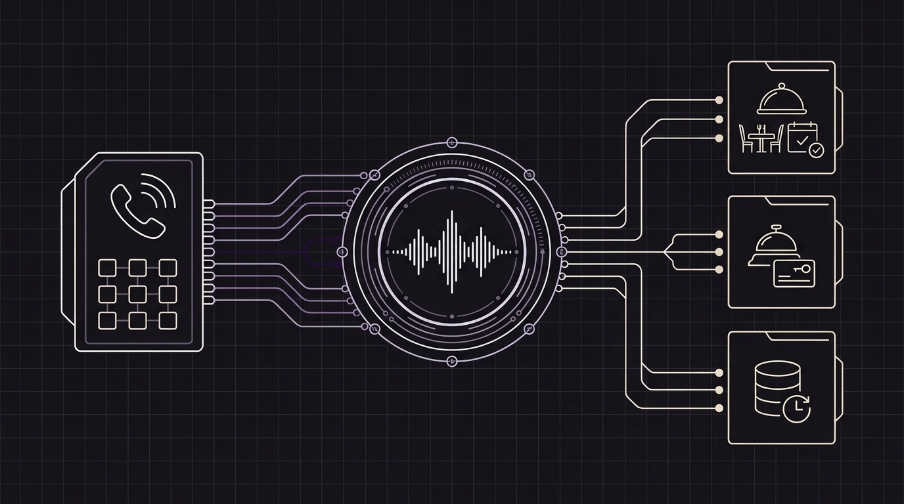

# Why Voice Agents Are the Obvious Solution for Restaurants, Hotels, and High-Touch Businesses—and How Orbitali Puts Them to Work

Walk into a busy restaurant at 8:00 PM on a Friday, or stand in front of a hotel reception desk at 3:00 PM during peak check-in, and you will see the same problem play out every single day: **the phone is ringing, and the person best equipped to answer it is already taking care of a guest standing right in front of them.**

If the host picks up the phone, the guest at the door waits awkwardly while someone on the line asks whether there is patio seating or gluten-free pasta. If the host ignores the phone to welcome the guest in person, the caller hits voicemail, hangs up, and books a table down the street.

For decades, hospitality and local businesses treated this dilemma as an unavoidable cost of doing business. You either paid for extra front-desk staff just to survive rush hour, frustrated callers with rigid *"Press 1 for reservations, press 2 for reception"* phone menus, or accepted that dozens of calls—and the bookings attached to them—would simply slip away every week.

Today, **AI voice agents** make that tradeoff a thing of the past. Here is why voice assistants have become the most natural upgrade for restaurants, hotels, and other customer-facing businesses—and how **Orbitali** makes it simple to create them and put them to work.

---

## 1. The Rush-Hour Paradox in Restaurants and Hotels

Restaurants and hotels share a frustrating operational reality: **customers call the most at the exact moments when your team has the least time to answer.**

* **In restaurants**, the phone rings off the hook during prep hours and right in the middle of lunch and dinner service—when hosts are seating guests, servers are carrying plates, and managers are running the floor.
* **In hotels**, calls spike during morning check-out, afternoon check-in, and late at night, when a single staff member is often managing the entire front desk.

Even in an era of online booking apps, the telephone remains one of the highest-converting sales channels in hospitality. When a guest calls a restaurant or hotel today, it isn't because they don't know how to use a website. They call because **their question is immediate, personal, or slightly outside the box**:

* *"We're ten minutes away—can you hold our table, and is there space for a stroller?"*
* *"Our flight just landed late. Is reception still open after midnight, and do you have a spot left in your parking garage?"*
* *"Can you fit a table of eight this Saturday, and do you have vegan or celiac-friendly options?"*
* *"Can we request a quiet room on a higher floor and add breakfast for tomorrow morning?"*

Online booking calendars are built for standard clicks, not reassurance. A customer walking to their car or waiting at an airport gate doesn't want to pinch-and-zoom through a PDF menu or fill out a six-step mobile form. They want a quick, friendly 20-second conversation that solves their problem on the spot.

---

## 2. It's Not Just Hospitality: Every Busy Service Business Faces the Same Bottleneck

While restaurants and hotels are the clearest examples, the exact same problem happens in almost every business where staff work hands-on with customers in person:

* **Medical, Dental, and Veterinary Clinics:** Receptionists are checking in patients and handling payments at the counter while the phone rings nonstop with appointment requests, rescheduling, and directions.
* **Hair Salons, Barbershops, and Spas:** Stylists and therapists have their hands full with clients in the chair and cannot stop mid-session to answer questions about prices or open slots.
* **Auto Repair Shops and Home Services:** Mechanics and technicians are working on vehicles or out on service calls while customers phone in with urgent breakdowns or quote requests.
* **Real Estate Agencies and Property Managers:** Agents are showing properties in person while prospective buyers and tenants call to ask about listings or schedule a viewing.
* **Gyms, Yoga Studios, and Local Academies:** Instructors are teaching a class while new leads call to ask about trial sessions, schedules, and memberships.

In all of these businesses, **roughly 70% to 80% of incoming calls are repetitive and predictable**: answering everyday questions (opening hours, parking, pricing, policies), checking availability on the calendar, booking or moving a reservation, and passing urgent matters to the right person.

---

## 3. Why Voice Agents Protect Hospitality Instead of Replacing It

A common worry among restaurant owners, hoteliers, and clinic managers is that automating the phone might make their business feel cold or impersonal. In practice, the exact opposite happens: **a voice agent gives your human team the breathing room to be genuinely hospitable.**

Nothing ruins a warm welcome faster than a receptionist holding up a finger to a guest in the lobby because they are stuck on the phone repeating the Wi-Fi password, parking directions, or closing time for the twentieth time that afternoon.

When an AI voice agent answers the phone instantly on the first ring:

1. **In-person guests get 100% of your team's attention:** Your hosts, receptionists, and specialists can look guests in the eye, smile, and focus on delivering an unforgettable in-person experience.
2. **Phone callers never wait on hold or hit voicemail:** Even if five people call at 8:15 PM on a Saturday night—or at 2:00 AM from another time zone—every caller is greeted immediately in a warm, natural voice.
3. **Every international guest feels welcome:** A hotel or tourist-area restaurant can effortlessly assist callers in English, Spanish, Italian, and other languages without needing a multilingual receptionist on every shift.

---

## 4. Why Traditional Phone Bots Failed—and What Changed

Until recently, "automating the phone" meant one of two bad options:

* **Old-school phone menus (*"Press 1, Press 2"*):** Callers hate them, and most people simply hang up and call the next option on Google Maps.
* **Early voice bots:** They sounded robotic, took several awkward seconds of silence before replying, and got confused if the caller interrupted them or changed their mind mid-sentence (*"Actually, make it for five people instead of four"*).

Modern real-time voice agents work differently. Instead of reading rigid scripts with awkward pauses, they hold a fluid, natural conversation. If a caller interrupts, changes the time of their reservation, or asks two questions at once, the assistant adapts immediately—just like a well-trained receptionist would.

---

## 5. How Orbitali Makes It Easy to Build Voice Agents and Put Them to Work

Historically, setting up this kind of advanced voice assistant required an engineering project that only huge hotel chains or airline call centers could afford.

**Orbitali** removes that complexity so that businesses, software platforms, and digital agencies can create a tailored voice receptionist and put it to work on a real phone line in a single afternoon:

### 1. Teach It Your Business Using the Documents You Already Have
You don't need to write complicated decision trees. Already have a PDF of your restaurant menu and allergen guide? A document with your hotel's check-in times, pet policy, and breakfast hours? A price list for your salon or clinic? Simply upload those documents into Orbitali. Your voice agent reads and understands your information immediately so it can answer customer questions with accuracy.

### 2. Connect It to Your Reservation Book or Calendar
Answering questions is only half the job—the real value is closing the booking. Orbitali connects directly with the reservation system, calendar, or management software your business already uses. During the call, the agent checks real-time availability, confirms a table or appointment, modifies an existing booking, or even recognizes a returning guest to welcome them back by name—all while keeping your customer data safely inside your own system.

### 3. Keep Your Existing Phone Number (With Zero Hidden Markups)
Your phone number is printed on your sign, listed on your Google profile, and saved in your regular customers' phones. With Orbitali's *Bring Your Own Carrier* approach, you never lose ownership of your number and you never pay inflated per-minute phone markups. You connect your existing line and your agent starts answering right away.

### 4. Hand Off to a Real Person Whenever Needed
A great voice receptionist knows when to handle a request on its own and when to bring in a teammate. If someone calls a restaurant to plan a 60-person wedding dinner, or a hotel guest has an urgent special request, the Orbitali agent smoothly transfers the call directly to the manager's phone or front-desk extension.

### 5. Complete Visibility and Peace of Mind
Every interaction begins with a clear, friendly notice that the caller is speaking with an AI assistant, and all voice processing takes place in Europe under strict privacy standards. From the Orbitali dashboard, you can review call summaries, see what questions customers are asking most often, and refine your agent's instructions anytime.

---

## Turn Every Ring Into a Confirmed Booking

In a restaurant, a hotel, a clinic, or any local service business, the phone shouldn't be a source of stress during your busiest hours—it should be your most reliable engine for new reservations.

By putting an **Orbitali** voice agent to work on your phone line, you stop losing customers to voicemail, free your team from repetitive interruptions, and ensure that every caller receives the same warm, immediate service as the guest walking through your front door.

*Want to see how an AI voice agent would sound for your restaurant, hotel, or business? Visit [orbitali.ai](https://orbitali.ai) or get in touch with our team at `info@orbitali.ai`.*
