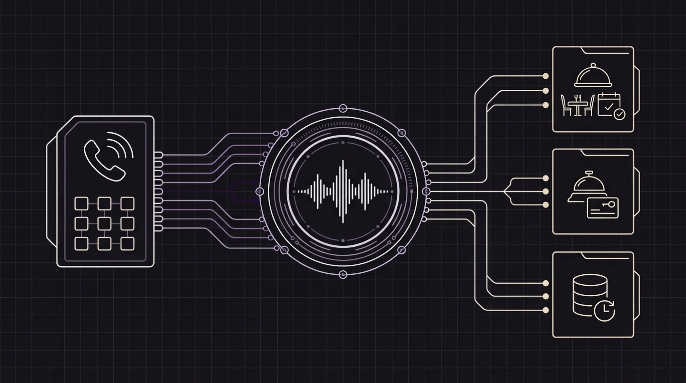

# Por qué los agentes de voz son la solución evidente para restaurantes, hoteles y negocios de atención presencial — y cómo Orbitali los pone a trabajar

Entra en un restaurante lleno un viernes a las 20:30 o acércate a la recepción de un hotel a las 15:00 en plena hora punta de llegadas y verás una escena que se repite todos los días: **el teléfono no deja de sonar y la persona más indicada para contestar ya está atendiendo a un cliente que tiene delante.**

Si el encargado descuelga el teléfono, el cliente que acaba de entrar tiene que esperar mientras alguien al otro lado de la línea pregunta si queda mesa en la terraza o si hay opciones sin gluten. Si ignora el teléfono para atender como se merece a quien está en el local, la llamada salta al buzón de voz, el cliente cuelga y reserva en el restaurante de la esquina.

Durante décadas, la hostelería y los negocios locales han asumido este dilema como algo inevitable. O contratabas más personal de recepción solo para cubrir los picos de llamadas, o encerrabas a los clientes en fríos menús automáticos de *«Pulse 1 para reservas, pulse 2 para recepción»*, o aceptabas que decenas de llamadas —y las reservas que traen consigo— se perdieran cada semana.

Hoy, los **agentes de voz con inteligencia artificial** dejan atrás ese problema. A continuación te contamos por qué los asistentes de voz se han convertido en el aliado más evidente para restaurantes, hoteles y negocios de cara al público, y cómo **Orbitali** hace que sea muy sencillo crearlos y ponerlos a trabajar.

---

## 1. La paradoja de las horas punta en restaurantes y hoteles

Los restaurantes y los hoteles comparten una realidad operativa muy clara: **los clientes llaman más justo en los momentos en que el equipo tiene menos tiempo para contestar.**

* **En los restaurantes**, el teléfono echa humo durante la preparación del turno y en mitad del servicio de comidas y cenas: exactamente cuando el personal está recibiendo a los comensales, sacando platos o coordinando la sala.
* **En los hoteles**, las llamadas se disparan durante las salidas de la mañana, el check-in de la tarde y por la noche, cuando a menudo una sola persona está a cargo de toda la recepción.

Incluso en la era de las reservas por internet, el teléfono sigue siendo uno de los canales que más ventas cierra en hostelería. Cuando un cliente llama hoy a un restaurante o a un hotel, no es porque no sepa usar una página web; llama porque **su duda es inmediata, personal o se sale del formulario estándar**:

* *«Llegamos en diez minutos, ¿nos podéis guardar la mesa y tenéis hueco para un carrito de bebé?»*
* *«Nuestro vuelo acaba de aterrizar con retraso. ¿Sigue abierta la recepción después de medianoche y queda plaza en el parking?»*
* *«¿Tenéis mesa para ocho este sábado y contáis con opciones veganas o para celíacos?»*
* *«¿Podemos pedir una habitación tranquila en una planta alta y añadir desayuno para mañana?»*

Los calendarios web sirven para reservas estándar, pero no transmiten tranquilidad ni resuelven dudas al vuelo. Quien llama mientras camina hacia el coche o espera en el aeropuerto no quiere ampliar con los dedos un menú en PDF ni rellenar seis pantallas en el móvil: quiere una conversación amable de 20 segundos que le deje el problema resuelto al instante.

---

## 2. No es solo hostelería: cualquier negocio con trato presencial sufre el mismo cuello de botella

Aunque los restaurantes y los hoteles son el ejemplo más visible, exactamente el mismo problema ocurre en casi cualquier negocio donde el equipo trabaja con las manos y la atención puestas en el cliente presencial:

* **Clínicas dentales, médicas y veterinarias:** El personal de recepción recibe a los pacientes y gestiona cobros en mostrador mientras el teléfono suena sin parar para pedir cita, cambiar una hora o preguntar cómo llegar.
* **Peluquerías, barberías, centros de estética y spas:** Los profesionales están atendiendo a un cliente y no pueden dejar un servicio a medias para contestar preguntas sobre precios o huecos libres en la agenda.
* **Talleres mecánicos y servicios para el hogar:** Los técnicos están trabajando en los vehículos o fuera del taller mientras entran llamadas urgentes por averías o presupuestos.
* **Agencias inmobiliarias y administradores de fincas:** Los agentes están enseñando un piso en persona mientras posibles compradores o inquilinos llaman para pedir información y agendar visitas.
* **Gimnasios, estudios de yoga y academias:** Los instructores están impartiendo clase mientras llaman nuevos interesados preguntando por horarios, clases de prueba y tarifas.

En todos estos sectores, **entre el 70 % y el 80 % de las llamadas entrantes son repetitivas y predecibles**: responder preguntas habituales (horarios, aparcamiento, precios, normas), mirar qué huecos hay libres en la agenda, confirmar o cambiar una reserva y pasar los asuntos urgentes a la persona adecuada.

---

## 3. Por qué los agentes de voz protegen el trato humano en lugar de sustituirlo

Una duda habitual entre hosteleros, directores de hotel y responsables de clínicas es si automatizar el teléfono hará que su negocio parezca frío o distante. En la práctica ocurre justo lo contrario: **un agente de voz devuelve a tu equipo el tiempo necesario para ofrecer una hospitalidad de verdad.**

Nada rompe más rápido una buena bienvenida que ver al recepcionista levantar un dedo pidiendo espera al cliente que acaba de entrar porque está atrapado al teléfono repitiendo por vigésima vez la dirección del parking o la hora de cierre.

Cuando un agente de voz con IA contesta al primer tono:

1. **Los clientes presenciales reciben el 100 % de la atención de tu equipo:** Tus camareros, recepcionistas y especialistas pueden mirar a los ojos, sonreír y centrarse en quienes están dentro del local.
2. **Quien llama por teléfono nunca espera ni cae en el buzón de voz:** Aunque llamen cinco personas a la vez un sábado a las 21:15 —o a las dos de la madrugada desde otro país—, todas reciben respuesta al instante con una voz cálida y natural.
3. **Los clientes internacionales se sienten como en casa:** Un hotel o un restaurante en una zona turística puede atender llamadas en español, inglés, italiano y otros idiomas con total fluidez, sin exigir que cada turno domine varios idiomas.

---

## 4. Por qué fracasaron los antiguos bots telefónicos y qué ha cambiado

Hasta hace muy poco, «automatizar el teléfono» significaba elegir entre dos malas opciones:

* **Las locuciones clásicas (*«Pulse 1, pulse 2»*):** A nadie le gusta hablar con un menú numérico; la mayoría de las personas cuelgan y llaman al siguiente negocio que aparece en Google Maps.
* **Los primeros bots de voz:** Sonaban robóticos, dejaban silencios incómodos de varios segundos antes de contestar y se bloqueaban si el cliente los interrumpía o cambiaba de idea a mitad de frase (*«Mejor apúntanos para cinco personas en lugar de cuatro»*).

Los agentes de voz en tiempo real actuales funcionan de otra manera. En lugar de leer guiones rígidos con pausas artificiales, mantienen una conversación fluida y natural. Si el cliente interrumpe, cambia la hora de su reserva o hace dos preguntas seguidas, el asistente se adapta al momento igual que lo haría un buen recepcionista.

---

## 5. Cómo Orbitali hace que sea fácil crear agentes de voz y ponerlos a trabajar

Antes, poner en marcha un asistente de voz de este nivel requería un proyecto técnico enorme que solo las grandes cadenas hoteleras o aerolíneas podían permitirse.

**Orbitali** elimina toda esa complicación para que empresas, plataformas de software para hostelería y agencias digitales puedan configurar un recepcionista de voz a medida y ponerlo a funcionar en una línea telefónica real en una sola tarde:

### 1. Enséñale cómo funciona tu negocio con los documentos que ya tienes
No necesitas diseñar complicados esquemas de conversación. ¿Ya tienes un PDF con la carta de tu restaurante y la tabla de alérgenos? ¿Un documento con los horarios de check-in del hotel, las normas sobre mascotas y el horario del desayuno? ¿Una lista de tarifas de tu clínica o salón? Solo tienes que subir esos archivos a Orbitali. El agente aprende la información al instante para responder a las dudas de tus clientes con total precisión.

### 2. Conéctalo con tu libro de reservas o tu agenda
Resolver dudas es solo la mitad del trabajo; el verdadero valor está en dejar la reserva cerrada. Orbitali se conecta con el sistema de reservas, calendario o programa de gestión que ya utilizas. Durante la llamada, el agente consulta la disponibilidad en tiempo real, deja confirmada la mesa, habitación o cita, modifica una reserva existente e incluso reconoce a los clientes habituales para saludarlos por su nombre, manteniendo todos los datos de tus clientes a salvo en tu propio sistema.

### 3. Conserva tu número de teléfono de siempre (sin recargos ocultos)
Tu número de teléfono está en tu fachada, en tu ficha de Google y en la agenda de tus clientes de toda la vida. Con Orbitali conservas siempre la titularidad de tus números y tu operador telefónico, sin pagar recargos por minuto. Conectas tu línea actual y tu agente empieza a atender llamadas desde el primer día.

### 4. Pasa la llamada a una persona de tu equipo cuando haga falta
Un buen recepcionista sabe cuándo resolver una gestión por su cuenta y cuándo avisar a un compañero. Si alguien llama al restaurante para organizar una celebración de 60 personas o un huésped del hotel tiene una urgencia, el agente de Orbitali transfiere la llamada en el acto al teléfono del encargado o a la extensión de recepción.

### 5. Control total y máxima tranquilidad
Cada llamada comienza con un aviso breve y natural indicando que atiende un asistente con inteligencia artificial, y todo el procesamiento de voz se realiza en Europa cumpliendo con los estándares de privacidad. Desde el panel de Orbitali puedes consultar el resumen de cada llamada, descubrir qué preguntan más tus clientes y ajustar las instrucciones de tu agente en cualquier momento.

---

## Convierte cada llamada en una reserva confirmada

En un restaurante, un hotel, una clínica o cualquier negocio de servicios, el teléfono no debería ser una fuente de estrés en las horas de más trabajo, sino tu motor más fiable para captar nuevas reservas.

Al poner a trabajar un agente de voz de **Orbitali** en tu línea telefónica, dejas de perder clientes en el buzón de voz, liberas a tu equipo de interrupciones constantes y garantizas que cada persona que llama reciba la misma atención rápida y amable que quien cruza tu puerta.

*¿Quieres escuchar cómo sonaría un agente de voz con IA en tu restaurante, hotel o negocio? Visita [orbitali.ai](https://orbitali.ai) o escríbenos a `info@orbitali.ai`.*
