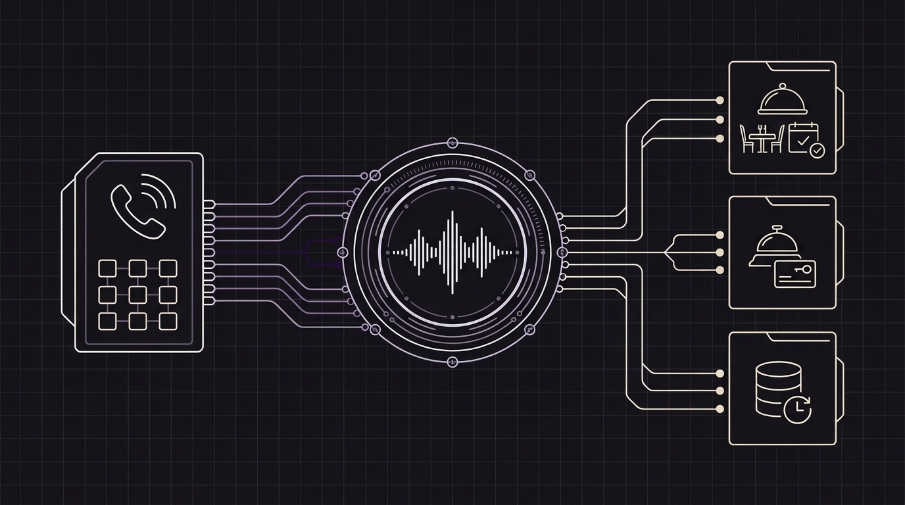

# Perché gli agenti vocali sono la soluzione ovvia per ristoranti, hotel e attività ad alto contatto — e come Orbitali li mette al lavoro

Entra in un ristorante affollato il venerdì alle 20:30, o fermati davanti alla reception di un hotel alle 15:00 nel pieno dei check-in, e assisterai a una scena che si ripete ogni singolo giorno: **il telefono squilla senza sosta e la persona più adatta a rispondere sta già assistendo un ospite in carne e ossa proprio di fronte a sé.**

Se il responsabile di sala risponde al telefono, l'ospite appena entrato resta in attesa mentre qualcuno all'altro capo della linea chiede se c'è posto in terrazza o se sono disponibili piatti senza glutine. Se invece ignora il telefono per accogliere con cura chi ha davanti, la chiamata finisce in segreteria, il cliente riaggancia e prenota un tavolo nel locale accanto.

Per decenni, il mondo della ristorazione, dell'ospitalità e dei servizi locali ha vissuto questo compromesso come qualcosa di inevitabile. O si assumeva personale extra solo per coprire i picchi di telefonate, o si costringevano i clienti a passare per freddi menu automatici del tipo *«Premi 1 per le prenotazioni, premi 2 per la reception»*, oppure si accettava di perdere decine di chiamate — e di prenotazioni — ogni settimana.

Oggi gli **agenti vocali con intelligenza artificiale** rendono questo compromesso un ricordo del passato. Vediamo perché gli assistenti vocali sono diventati la soluzione più naturale per ristoranti, hotel e attività a stretto contatto con il pubblico — e come **Orbitali** rende semplice crearli e metterli subito al lavoro.

---

## 1. Il paradosso delle ore di punta nei ristoranti e negli hotel

Ristoranti e strutture ricettive condividono una realtà operativa tanto semplice quanto frustrante: **i clienti chiamano di più proprio nei momenti in cui il personale ha meno tempo per rispondere.**

* **Nei ristoranti**, il telefono squilla all'impazzata durante la preparazione della linea e nel pieno del servizio di pranzo e cena, esattamente quando chi lavora in sala sta accompagnando gli ospiti al tavolo, portando i piatti o gestendo la cassa.
* **Negli hotel**, le chiamate si concentrano durante i check-out del mattino, gli arrivi del pomeriggio e a tarda notte, quando spesso un solo addetto presidia l'intera reception.

Anche nell'era delle prenotazioni online, il telefono resta uno dei canali che converte di più nel settore dell'ospitalità. Quando oggi un ospite telefona a un ristorante o a un albergo, non lo fa perché non sa usare un sito web; chiama perché **la sua richiesta è urgente, personale o esce dagli schemi standard**:

* *«Siamo a dieci minuti da voi: potete tenerci il tavolo? E c'è spazio per un passeggino?»*
* *«Il nostro volo è appena atterrato in ritardo. La reception è aperta dopo mezzanotte e c'è ancora posto nel vostro garage?»*
* *«Riuscite ad accomodare un tavolo da otto questo sabato? Avete opzioni vegane o per celiaci?»*
* *«Possiamo richiedere una camera silenziosa ai piani alti e aggiungere la colazione per domani mattina?»*

I moduli di prenotazione online sono pensati per clic standard, non per rassicurare un ospite in movimento. Chi chiama mentre cammina verso l'auto o aspetta al gate dell'aeroporto non vuole ingrandire con le dita un menu in PDF sullo smartphone o compilare un modulo di sei pagine: vuole una conversazione cordiale di 20 secondi che risolva subito la sua esigenza.

---

## 2. Non solo ospitalità: ogni attività a contatto con il pubblico vive lo stesso collo di bottiglia

Sebbene ristoranti e hotel siano gli esempi più immediati, lo stesso identico problema si presenta in quasi tutte le attività in cui il personale lavora a stretto contatto con i clienti presenti in sede:

* **Cliniche mediche, studi dentistici e veterinari:** La segreteria accoglie i pazienti e gestisce i pagamenti allo sportello mentre il telefono squilla di continuo per fissare appuntamenti, spostare orari o chiedere indicazioni.
* **Saloni di parrucchieri, barberie, centri estetici e spa:** I professionisti hanno le mani occupate con i clienti in poltrona o in cabina e non possono interrompere un trattamento per rispondere a domande su prezzi o disponibilità.
* **Autofficine e servizi per la casa:** I tecnici sono al lavoro sui veicoli o fuori sede per un intervento mentre arrivano chiamate urgenti per guasti o preventivi.
* **Agenzie immobiliari e property manager:** Gli agenti sono impegnati nelle visite agli immobili mentre potenziali acquirenti o inquilini telefonano per chiedere informazioni sugli annunci e fissare appuntamenti.
* **Palestre, studi yoga e scuole locali:** Gli istruttori stanno tenendo una lezione mentre nuovi interessati chiamano per informarsi su lezioni di prova, orari e abbonamenti.

In tutte queste realtà, **circa il 70%–80% delle chiamate in entrata è ripetitivo e prevedibile**: rispondere alle domande più frequenti (orari di apertura, parcheggio, tariffe, regole), controllare le disponibilità in agenda, confermare o modificare una prenotazione e passare le richieste urgenti alla persona giusta.

---

## 3. Perché gli agenti vocali proteggono l'ospitalità invece di sostituirla

Un dubbio frequente tra ristoratori, albergatori e responsabili di studio è che automatizzare il telefono possa far sembrare l'attività fredda o impersonale. Nella pratica accade esattamente l'opposto: **un agente vocale restituisce al tuo team la serenità e il tempo necessari per offrire un'ospitalità autentica.**

Nulla rovina un'accoglienza calorosa quanto vedere il receptionist alzare un dito per chiedere di pazientare all'ospite appena entrato perché è bloccato al telefono a ripetere per la ventesima volta le indicazioni per il parcheggio o l'orario di chiusura.

Quando un agente vocale IA risponde al primo squillo:

1. **Gli ospiti presenti in sala o in reception ricevono il 100% dell'attenzione:** Il tuo staff può guardare i clienti negli occhi, sorridere e dedicarsi completamente a chi ha di fronte.
2. **Chi chiama al telefono non resta mai in attesa né finisce in segreteria:** Anche se cinque persone chiamano contemporaneamente il sabato sera alle 20:15 — o alle due di notte da un altro fuso orario — ogni chiamante riceve subito una risposta cordiale e naturale.
3. **Ogni ospite internazionale si sente accolto:** Un hotel o un ristorante in una località turistica può assistere i clienti in italiano, inglese, spagnolo e altre lingue con assoluta naturalezza, senza richiedere personale multilingue in ogni turno.

---

## 4. Perché i vecchi risponditore automatici fallivano — e cosa è cambiato

Fino a poco tempo fa, «automatizzare il telefono» significava scegliere tra due soluzioni frustranti:

* **I vecchi menu telefonici (*«Premi 1, premi 2»*):** Nessuno ama parlare con una tastiera numerica; la maggior parte delle persone riaggancia e chiama il concorrente successivo su Google Maps.
* **I primi bot vocali:** Avevano una voce metallica, lasciavano lunghi silenzi imbarazzanti prima di rispondere e andavano in confusione se il cliente li interrompeva o cambiava idea a metà frase (*«Anzi, facciamo per cinque persone invece di quattro»*).

I moderni agenti vocali in tempo reale funzionano in modo completamente diverso. Invece di recitare copioni rigidi con pause innaturali, sostengono una conversazione fluida e spontanea. Se il chiamante interrompe, cambia l'orario della prenotazione o fa due domande insieme, l'assistente si adatta all'istante, proprio come farebbe un ottimo addetto alla reception.

---

## 5. Come Orbitali rende semplice creare agenti vocali e metterli al lavoro

In passato, attivare un assistente vocale di questo livello richiedeva mesi di sviluppo che solo le grandi catene alberghiere o le compagnie aeree potevano permettersi.

**Orbitali** elimina ogni complessità affinché aziende, software gestionali per l'ospitalità e agenzie digitali possano creare un receptionist vocale su misura e attivarlo su una vera linea telefonica in un solo pomeriggio:

### 1. Insegnagli tutto sulla tua attività usando i documenti che hai già
Non serve progettare complicati flussi di conversazione. Hai già un PDF con il menu del ristorante e l'elenco degli allergeni? Un documento con gli orari di check-in dell'hotel, le regole sugli animali domestici e gli orari della colazione? Un listino prezzi del tuo salone o della tua clinica? Ti basta caricare questi documenti su Orbitali: l'agente vocale impara subito le informazioni e risponde con precisione alle domande dei clienti.

### 2. Collegalo alla tua agenda o al tuo sistema di prenotazione
Rispondere alle domande è solo metà del lavoro; il vero valore è confermare la prenotazione. Orbitali si collega direttamente al calendario, al registro prenotazioni o al software gestionale che usi già ogni giorno. Durante la chiamata, l'agente controlla le disponibilità in tempo reale, prenota un tavolo, una camera o un appuntamento, modifica una prenotazione esistente e può persino riconoscere gli ospiti abituali per salutarli per nome, mantenendo tutti i dati dei clienti al sicuro nel tuo sistema.

### 3. Mantieni il tuo numero di telefono di sempre (senza ricarichi nascosti)
Il tuo numero di telefono è stampato sull'insegna, pubblicato sulla scheda Google e salvato nella rubrica dei tuoi clienti abituali. Con Orbitali mantieni sempre la proprietà del tuo numero e il tuo operatore telefonico, senza pagare ricarichi sul traffico telefonico. Colleghi la tua linea esistente e l'agente inizia subito a rispondere.

### 4. Passa la chiamata a una persona del tuo team quando serve
Un ottimo receptionist sa quando gestire una richiesta in autonomia e quando coinvolgere un collega. Se qualcuno chiama il ristorante per organizzare un ricevimento da 60 persone o se un ospite dell'hotel ha un'esigenza urgente, l'agente di Orbitali trasferisce immediatamente la chiamata al telefono del responsabile o all'interno della reception.

### 5. Massima trasparenza e tranquillità
Ogni conversazione inizia con un breve e cordiale avviso che informa il chiamante di parlare con un assistente dotato di intelligenza artificiale, e tutta l'elaborazione vocale avviene in Europa nel pieno rispetto delle normative sulla privacy. Dal pannello di controllo di Orbitali puoi consultare il riepilogo delle chiamate, scoprire quali sono le domande più frequenti dei tuoi clienti e perfezionare le istruzioni del tuo agente in qualsiasi momento.

---

## Trasforma ogni squillo in una prenotazione confermata

In un ristorante, in un hotel, in una clinica o in qualsiasi attività di servizi locali, il telefono non dovrebbe essere una fonte di stress nelle ore di punta, ma il tuo alleato più affidabile per acquisire nuove prenotazioni.

Mettendo al lavoro un agente vocale **Orbitali** sulla tua linea telefonica, smetti di perdere clienti a causa della segreteria, liberi il tuo staff dalle continue interruzioni e garantisci a chiunque chiami la stessa accoglienza rapida e premurosa riservata a chi entra dalla porta principale.

*Vuoi scoprire come suonerebbe un agente vocale IA nel tuo ristorante, hotel o attività? Visita [orbitali.ai](https://orbitali.ai) o contattaci a `info@orbitali.ai`.*
